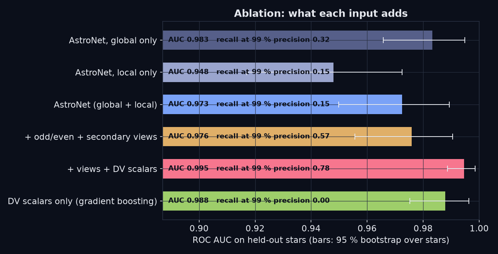
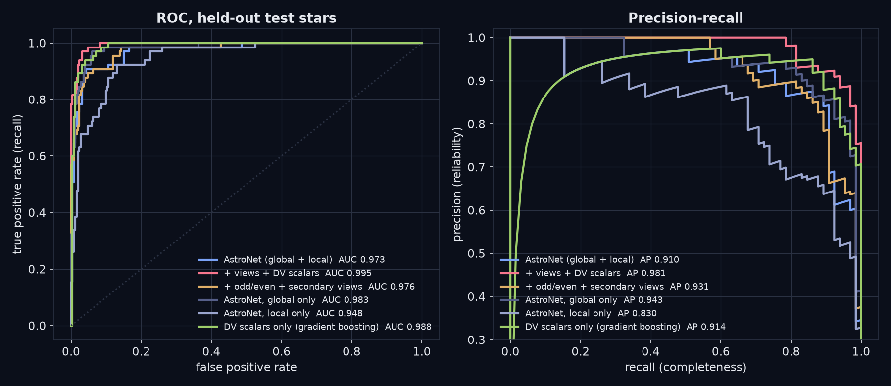
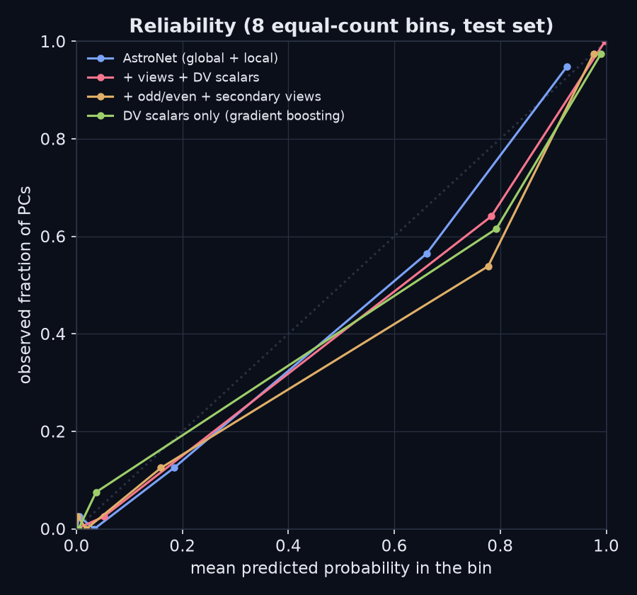
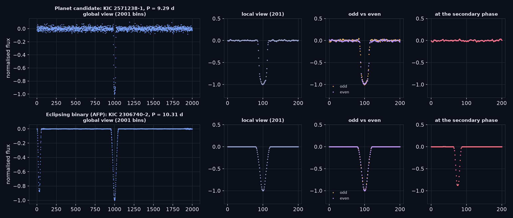
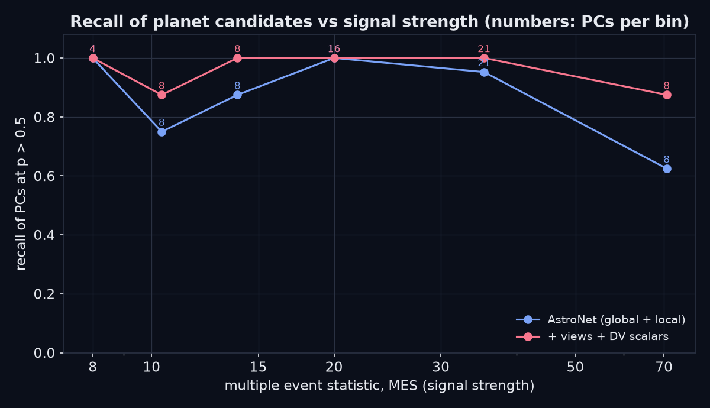

# exoplanet-cnn

**A 1D convolutional network that vets Kepler transit signals: AstroNet (Shallue & Vanderburg 2018)
reproduced from the raw light curves, then extended with the diagnostic views an expert checks
(odd/even transits, secondary eclipse, DV statistics) in the spirit of ExoMiner (Valizadegan et al., arXiv:2111.10009).**

When a transit search finds a periodic dip, it is usually *not* a planet: most such signals are eclipsing
binaries or instrumental noise. This repository learns to tell them apart from the 15,737 labelled Kepler DR24
Threshold Crossing Events, and measures honestly how much each extra input helps.

Built for the [Kister Space](https://www.youtube.com/@KisterSpace) search for planets around white dwarfs in
public TESS and Gaia data, where the same vetting problem appears on every candidate.



## Results

Test set: **318 TCEs (65 planet candidates) on 190 held-out stars**, never used for training, early stopping or
the learning-rate choice. Ensembles average 5 seeds (3 for the single-view and views-only variants); intervals
are 95 % bootstraps that resample whole stars.

| model | ROC AUC [95 % CI] | avg. precision | accuracy | precision / recall at p = 0.5 | recall at 95 % precision | recall at 99 % precision |
|---|---|---|---|---|---|---|
| AstroNet, global + local (reproduction) | 0.973 [0.950, 0.989] | 0.910 | 0.947 | 0.853 / 0.892 | 0.646 | 0.154 |
| AstroNet, global view only | 0.983 [0.966, 0.995] | 0.943 | 0.947 | 0.808 / 0.969 | 0.631 | 0.323 |
| AstroNet, local view only | 0.948 [0.917, 0.973] | 0.830 | 0.887 | 0.710 / 0.754 | 0.154 | 0.154 |
| + odd/even + secondary views | 0.976 [0.956, 0.991] | 0.931 | 0.931 | 0.795 / 0.892 | 0.662 | 0.569 |
| **+ views + DV scalars (extended)** | **0.995 [0.989, 0.999]** | **0.981** | **0.969** | 0.887 / 0.969 | **0.815** | **0.785** |
| DV scalars only, gradient boosting (no light curve) | 0.988 [0.975, 0.996] | 0.914 | 0.950 | 0.836 / 0.938 | 0.738 | 0.000 |

Full tables with Brier score, expected calibration error and per-seed spread: `results/metrics_test.md` and
`results/metrics_val.md`; per-TCE test predictions in `results/runs/`.

**Against the paper.** Shallue & Vanderburg (2018, Tables 1–2) report, on 1,523 test TCEs drawn from all
15,737: AUC 0.988 and accuracy 0.960 for the convolutional global + local model, 0.985 for global only and 0.973
for local only. With a fifth of the data and a stricter star-level split, our reproduction reaches AUC 0.973 and
accuracy 0.947; the paper's AUC lies inside our interval. As in the paper, the convolutional global view beats
the local view on its own.

**What the extension adds, read honestly.**

* The extended network is the best model on every ranking metric. At a reliability of 99 % it still recovers 51
  of the 65 test planets (recall 0.785); AstroNet recovers 10.
* Most of the gain comes from the **DV scalars**, not from the new views. Odd/even and secondary views alone move
  the AUC from 0.973 to 0.976, inside the noise, though they raise recall at 99 % precision from 0.15 to 0.57.
* The catalogue numbers alone (gradient boosting, no light curve) already give AUC 0.988, but their single most
  confident TCE is a false positive (KIC 8176650-2, an AFP), so they reach no planet at all at 99 % precision.
  The light-curve views fix the top of the ranking and the scalars fix the rest; together they beat either one.
* With 65 test planets, differences among the light-curve-only variants (0.948–0.983) are not significant.

ExoMiner reports recall 0.936 at precision 0.99 on its own Kepler DR25 test set (Valizadegan et al., abstract).
Its catalogue, labels and inputs (centroid time series among them) differ from ours, so the numbers are not
directly comparable.

| | |
|---|---|
|  |  |
|  |  |

* `figures/example_views.png`: the five inputs for a planet candidate and an eclipsing binary with a secondary
  eclipse near half phase in the global view.
* `figures/recall_vs_mes.png`: test planets recovered at p > 0.5 by signal strength (MES), with the count per bin.
  AstroNet loses 3 of the 8 planets above MES 50 (deep transits that look binary-like); the extended net loses 1.
* `figures/occlusion.png`: the paper's occlusion test (its Fig. 8) on our AstroNet. For the binary shown the score
  stays near 0 even with the secondary hidden; as the paper says of its own example, the V-shaped primary is
  evidence enough.
* `figures/training_curves.png`: validation AUC per epoch for every seed.

## Pipeline

| step | command | what happens |
|---|---|---|
| download | `exocnn download --stars 1900` | DR24 TCE table from the NASA Exoplanet Archive TAP service; a reproducible random sample of host stars; every Kepler long-cadence quarter of those stars from MAST (resumable, parallel, retries with back-off) |
| preprocess | `exocnn preprocess` | PDCSAP flux, quality-flagged cadences dropped, each quarter normalised; a cubic spline divided out per star, with all TCE transits masked, 3σ outliers iteratively clipped and the break-point spacing (0.5–20 d) chosen by BIC; the other TCEs' transits removed (unless their period is commensurate, see below); five views per TCE |
| train | `exocnn train --model astronet --seeds 5` | Adam, binary cross-entropy, batch 64, random horizontal reflection; each seed keeps its best epoch on validation AUC |
| evaluate | `exocnn evaluate` | ensemble metrics on held-out stars, with 95 % bootstrap intervals that resample stars |
| figures | `exocnn figures` | everything in `figures/` |
| all of the above | `python -m exocnn.experiments` | learning-rate choice on validation, then every ensemble in the tables |

Data go to `~/.exocnn` (or `$EXOCNN_DATA`); nothing downloaded is committed.

### Inputs

| view | length | definition | source |
|---|---|---|---|
| global | 2001 | whole orbit, bin width = spacing = P/2001 | S&V 2018, Sec. 5.2 |
| local | 201 | ±4 transit durations, spacing 8d/201, width 0.16 d | S&V 2018, Sec. 5.2 |
| odd, even | 201 each | local view of odd-numbered and even-numbered transits | ExoMiner, Sec. 3.3 |
| secondary | 201 | local view centred on the strongest secondary event (`tce_maxmesd`) | ExoMiner, Sec. 3.3 |
| scalars | 16 | period, duration, depth, radius, impact, SNR, MES, number of transits, odd/even statistic, secondary MES, centroid-offset significances (KIC and out-of-transit), bootstrap false-alarm probability, stellar Teff, log g, radius | DR24 DV values |

Global and local views are normalised to median 0 and minimum −1, as in the paper. Odd, even and secondary
views reuse the *local view's* median and depth, so that an odd/even depth difference or a secondary eclipse
is not stretched away by the normalisation.

### Networks

* **AstroNet** exactly as in S&V 2018, Fig. 7: global column conv5-16 ×2 → maxpool5/2 → … → conv5-256 ×2 →
  maxpool5/2; local column conv5-16 ×2 → maxpool7/2 → conv5-32 ×2 → maxpool7/2; four FC-512; sigmoid.
* **Extended**: the same two columns, plus one local-type column applied with *shared weights* to the odd and
  the even view whose features are subtracted (ExoMiner's subtraction layer), a column for the secondary
  view, and an MLP for the scalars. Each branch ends in an FC-128 layer so all branches contribute equally;
  three FC-512 layers with dropout 0.3.
* **Scalars only**: gradient-boosted trees on the 16 DV numbers and no light curve at all. It is there to
  show how much of the score the catalogue statistics carry by themselves.

## Data actually used

* **TCE table:** `q1_q17_dr24_tce` from the NASA Exoplanet Archive TAP service (columns in `exocnn/config.py`).
  Labels come from `av_training_set`: PC positive; AFP and NTP negative; UNK ignored. That is 3,600 PC, 9,596
  AFP and 2,541 NTP, the same counts as the paper (Sec. 3.1).
* **Subset:** 1,900 of the 9,865 host stars, a uniform random sample (seed 42). `--stars N` takes a prefix of one
  fixed permutation, so a larger run extends a smaller one.
  * It holds 3,043 labelled TCEs: 730 PC, 1,813 AFP, 500 NTP (`results/subset_tces.csv`).
  * Every long-cadence quarter of those stars came from MAST: 13.2 GB.
  * The full labelled set would be about 70 GB at the ~7 MB per star we measured.
* **Split by star**, 80/10/10. The paper split by TCE. Grouping by star keeps two TCEs of one eclipsing binary
  (primary and secondary, or period aliases) from sitting on both sides of the split.

  | split | TCEs | PC | AFP | NTP |
  |---|---|---|---|---|
  | train | 2,429 | 596 | 1,430 | 403 |
  | val | 296 | 69 | 183 | 44 |
  | test | 318 | 65 | 200 | 53 |

## Training protocol

* **Learning rate.** The paper's α = 1e-5 (Adam) came out of a large hyperparameter search on five times more
  data, and on our subset it learns too slowly: after 30 epochs AstroNet's validation AUC was 0.698 at 1e-5 and
  0.966 at 1e-4. The rate was picked on validation from {1e-5, 1e-4} for AstroNet and for the extended network
  (1e-4 won both; `results/runs/lr_choice.json`) and reused for the other variants.
* **Training.** Every model trains for 60 epochs, batch 64, with random horizontal flips, and keeps the epoch
  with the best validation AUC.
* **Test set.** It was used once, for the tables above.
* **Cost.** One AstroNet seed takes about 1.2 minutes on an RTX 5070. Preprocessing takes about 1 s per star per
  CPU core.

## Deviations from the papers, and limitations

1. **Five times less data, and a small test set.** 65 test planets put roughly ±0.02 on every AUC. Treat
   differences inside the intervals as ties.
2. **Labels.** `av_training_set` has known mislabels; the paper (Sec. 3.1) cites KOI 2950.01 and 5308.01, two
   eclipsing binaries labelled PC. The labels were also partly made from DV diagnostics, so the scalar features
   may echo how the labels were made. The scalars-only baseline is reported to make that visible.
3. **Detrending.**
   * One spline per star, with every TCE's transits masked (±1 duration), instead of one fit per TCE.
   * The break-point grid is ours: 20 spacings, log-spaced from 0.5 to 20 d.
   * Only cadences with `SAP_QUALITY == 0` are kept.
4. **Other TCEs on the same star.**
   * The paper removed the transits of other *confirmed planets*. We remove the transits of every other TCE,
     except those whose period is commensurate with this one (integer or half-integer ratio, within 1 %).
   * For an eclipsing binary, those commensurate TCEs are the secondary eclipse or a period alias, i.e. the
     evidence itself.
   * An earlier version removed them too and erased binaries' own eclipses. We caught it in the example figure.
5. **Not the full ExoMiner.**
   * No centroid time series, no ghost or rolling-band diagnostics, and no hyperparameter search.
   * We bin at 2001/201; ExoMiner bins at 301/31.
   * The DR24 table has no values for `wst_depth`, `tce_albedo_stat` or `tce_ptemp_stat`, so they are not used.
6. **Not done yet:** an out-of-domain test on TESS TOIs, and the run on all 9,865 stars.

## Reproduce

```bash
pip install -e .[test]                    # PyTorch with CUDA recommended
export EXOCNN_DATA=/path/with/15GB/free   # default ~/.exocnn
exocnn download --stars 1900 --workers 6  # ~1 h, 13 GB
exocnn preprocess --workers 6             # ~30 min
python -m exocnn.experiments              # ~30 min on one GPU, writes the metrics to results/
exocnn figures
pytest                                    # offline tests on synthetic light curves
```

Trained weights (5 × 16 MB for the extended ensemble) are not in the repository; the run above regenerates them.

## References

* Shallue, C. J. & Vanderburg, A. 2018, *Identifying Exoplanets with Deep Learning: A Five-planet Resonant
  Chain around Kepler-80 and an Eighth Planet around Kepler-90*, AJ, arXiv:1712.05044.
* Valizadegan, H. et al., *ExoMiner: A Highly Accurate and Explainable Deep Learning Classifier that
  Validates 301 New Exoplanets*, ApJ (accepted November 2021), arXiv:2111.10009.
* Kepler Q1–Q17 DR24 TCE table, NASA Exoplanet Archive (`q1_q17_dr24_tce`); Kepler light curves from the
  Mikulski Archive for Space Telescopes (MAST).

## License and citation

MIT. If this is useful to you, please cite it (see `CITATION.cff`) and, above all, the two papers it builds on.
`LEARNING.md` (in Spanish) explains the ideas from scratch.
